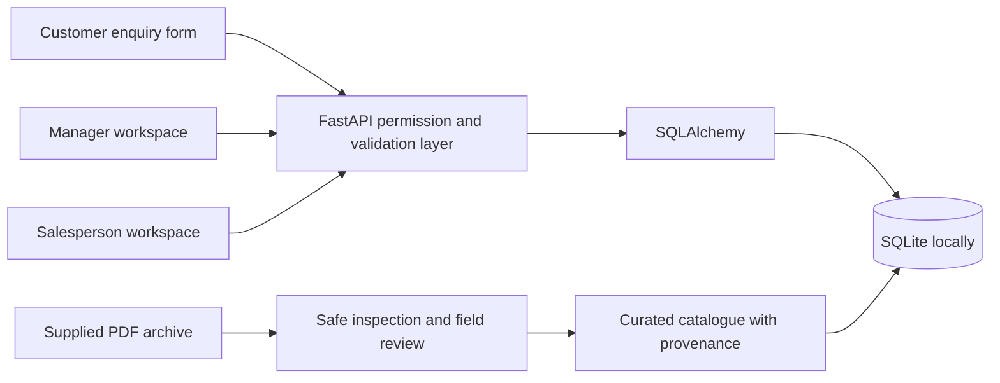

# Architecture and decisions

## Request path

One React app supplies three views. In the built demo, FastAPI serves both the frontend assets and API from one localhost address. During frontend development, Vite proxies API requests. There is no external runtime service, AI endpoint, email service, CDN dependency for the app, or payment setup.

FastAPI permits independent SQL libraries; SQLAlchemy keeps the persistence layer separate from HTTP and UI decisions. SQLite foreign keys are explicitly enabled. Reference: [FastAPI database guidance](https://fastapi.tiangolo.com/tutorial/sql-databases/) and [SQLAlchemy SQLite documentation](https://docs.sqlalchemy.org/en/20/dialects/sqlite.html).

## Permission model

| Operation | Customer | Salesperson | Manager |
| --- | --- | --- | --- |
| Submit enquiry | Public form | Public form | Public form |
| Read customer progress | Valid scoped token | — | — |
| Read enquiry details and history | No | Current assignments only | All |
| Assign/reassign/unassign | No | No | Yes |
| Read verified catalogue/PDFs | No | Yes | Yes |
| Create quotation draft | No | Current assignments only | No |
| Read private quotation versions | No | Current assignments only | Yes |

Referrers do not retain access merely because they sourced a lead. The original referrer is attribution; the current assignee is the permission owner. Both are foreign keys to staff users. General enquiries start unassigned. Valid referral enquiries start assigned to their referrer. Invalid referrals fail explicitly rather than silently misrouting a lead.

## Main records

- `users`: role, referral code and salted scrypt password hash.
- `sessions`: SHA-256 hash of a random session token and an eight-hour expiry; raw token is only in an HttpOnly SameSite=Strict cookie.
- `enquiries`: customer requirements/contact, original referrer, current assignee, optimistic revision, tracking token hash and expiry.
- `audit_events`: append-only through the API, with actor, timestamp, assignment before/after and reason. These are ordinary database rows, not tamper-proof legal records.
- `products`: reviewed facts, source evidence, price in integer paise and price kind.
- `quotations`: enquiry/version uniqueness, immutable item snapshots, total, notes, creator and status. There is no edit/delete/send endpoint in milestone 1.

## Data integrity and privacy

Assignment and quotation changes require the enquiry revision the user saw. SQLAlchemy checks the same revision on update; a competing assignment or draft causes a conflict instead of an unnoticed overwrite. Quotes and their audit event commit in one transaction. Uniqueness also protects quotation version numbering. Money uses integer paise rather than floating-point arithmetic.

The server reads product prices directly from the catalogue. The browser cannot provide a price or claim that an unreviewed model is verified. Quotes capture the fact and price values used at the time. Copying a quote into a new draft intentionally recalculates with the current catalogue when saved.

Tracking tokens are high-entropy random values. The URL uses a fragment (`/track#token`), which browsers do not send in HTTP requests. The app passes it in a dedicated header to the tracking endpoint; access logs therefore do not receive it as a URL path/query. Tracking returns only limited progress, property type, reference and responsible salesperson, not contact details, requirements, history or drafts. It expires after 30 days. Lost/expired-link reissue and token rotation are deferred.

Same-origin requests use a custom mutation header and an allowed-Origin check. There is no permissive CORS configuration. Local trusted hosts, body/input size limits, request-rate limits, no-store caching and basic browser security headers are present. API endpoints use parameterized ORM queries. React renders user strings as text.

## Prototype boundaries

This is a single-process local prototype. Rate limits are in memory and reset on restart; they are not suitable for multiple workers. No staff invitation, password-reset, account deactivation, customer contact verification, backup scheduler, upload handling, full-text catalogue search or pagination beyond the displayed latest-200 bound exists yet. It is not a production CRM.

Demo credentials are documented on the sign-in page. Development HTTP cookies intentionally lack Secure; a future HTTPS deployment must enable `COOKIE_SECURE=1` and configure actual trusted hosts/origins. OpenAPI documentation loads Swagger assets from a CDN when visited; operational screens use locally built assets. Staff source-PDF links return supplied PDFs, so those documents should remain local until sharing is authorized.

## Why SQLite now; PostgreSQL later

SQLite is a local file, has no server to maintain, and handles this small single-computer prototype. SQLAlchemy models, foreign keys, JSON snapshots, unique constraints, and an initial Alembic migration keep PostgreSQL migration feasible. PostgreSQL is open source, but hosted infrastructure can cost money.

Later migration plan:

1. Install PostgreSQL locally or use explicitly provided no-cost institutional infrastructure.
2. Add a PostgreSQL driver and configure `DATABASE_URL` in the environment (never commit credentials).
3. Apply Alembic migrations to a new empty PostgreSQL database.
4. Export and import SQLite records in foreign-key order; changing the URL does **not** move existing data.
5. Compare counts, hashes, quotation totals and ownership history; rerun integration/concurrency tests against PostgreSQL.
6. Switch only after a backup and successful verification.

No PostgreSQL runtime or migration claim is made for this release. Timestamps are explicit UTC ISO strings for now; if moving to timezone-aware database columns, use a deliberate migration rather than silently changing interpretation.
